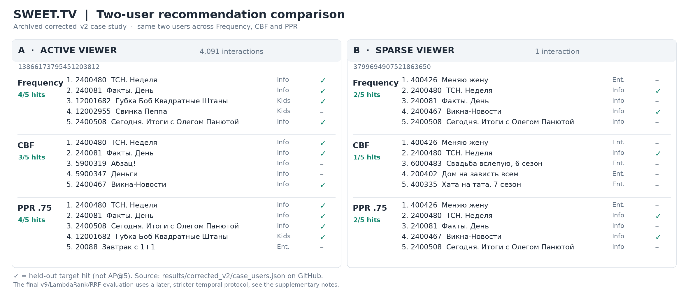

# SWEET.TV — Two-user recommendation case study (supplement)

Supplement to the individual LLM4Rec exam report. **This is additional documentation prepared after the submitted PDF; it does not replace the originally submitted report, model or final Kaggle CSV.**

## Scope, provenance, and experimental version

The two case users below were selected to contrast abundant and minimal watching history. Their full recommended lists (Frequency, content-based filtering / CBF, and Personalized PageRank / PPR with `alpha=0.75`) are copied from the repository's **archived, corrected-v2 case study**:

- Original evidence: [`results/corrected_v2/case_users.json`](../results/corrected_v2/case_users.json).
- Active user **13866173795451203812**: **4,091** training interactions.
- Sparse user **3799694907521863650**: **one** training interaction, for **400426 — «Меняю жену»** (entertainment).
- A `hit` means a recommended programme belongs to that case study's observed validation targets. **Hit counts are not AP@5 or MAP@5.**

**Important distinction:** This corrected-v2 illustration is *not* a new rerun on the stricter, later `T = 2020-05-18`, `U = 2020-07-27` protocol used to report the final method-level validation scores. The sets of results should not be presented as if measured on the same run. Both cases use the same two users and archived evaluation protocol within the corrected-v2 case-study file.

## User A — active viewer (4,091 training interactions)

| Method | Rank | Programme ID | Programme title (readable) | Category | Validation hit |
|---|---:|---:|---|---|:---:|
| Frequency | 1 | 2400480 | ТСН. Неделя | Инфо | ✓ |
| Frequency | 2 | 240081 | Факты. День | Инфо | ✓ |
| Frequency | 3 | 12001682 | Губка Боб Квадратные Штаны | Детям | ✓ |
| Frequency | 4 | 12002955 | Свинка Пеппа | Детям | — |
| Frequency | 5 | 2400508 | Сегодня. Итоги с Олегом Панютой | Инфо | ✓ |
| CBF | 1 | 2400480 | ТСН. Неделя | Инфо | ✓ |
| CBF | 2 | 240081 | Факты. День | Инфо | ✓ |
| CBF | 3 | 5900319 | Абзац! | Инфо | — |
| CBF | 4 | 5900347 | Деньги | Инфо | — |
| CBF | 5 | 2400467 | Викна-Новости | Инфо | ✓ |
| PPR (0.75) | 1 | 2400480 | ТСН. Неделя | Инфо | ✓ |
| PPR (0.75) | 2 | 240081 | Факты. День | Инфо | ✓ |
| PPR (0.75) | 3 | 2400508 | Сегодня. Итоги с Олегом Панютой | Инфо | ✓ |
| PPR (0.75) | 4 | 12001682 | Губка Боб Квадратные Штаны | Детям | ✓ |
| PPR (0.75) | 5 | 20088 | Завтрак с 1+1 | Развлечения | — |

**Interpretation:** Frequency and PPR each contain **4/5** observed target IDs; CBF has **3/5**. Frequency/PPR retain a mixture of information and children's programmes, whereas all five CBF recommendations belong to the information category. This is an observable difference in the *recommendation lists*, not proof that one method leads to greater satisfaction.

## User B — sparse viewer (one training interaction)

| Method | Rank | Programme ID | Programme title (readable) | Category | Validation hit |
|---|---:|---:|---|---|:---:|
| Frequency | 1 | 400426 | Меняю жену | Развлечения | — |
| Frequency | 2 | 2400480 | ТСН. Неделя | Инфо | ✓ |
| Frequency | 3 | 240081 | Факты. День | Инфо | — |
| Frequency | 4 | 2400467 | Викна-Новости | Инфо | ✓ |
| Frequency | 5 | 2400508 | Сегодня. Итоги с Олегом Панютой | Инфо | — |
| CBF | 1 | 400426 | Меняю жену | Развлечения | — |
| CBF | 2 | 2400480 | ТСН. Неделя | Инфо | ✓ |
| CBF | 3 | 6000483 | Свадьба вслепую, 6 сезон, 7 эп. | Развлечения | — |
| CBF | 4 | 200402 | Дом на зависть всем | Развлечения | — |
| CBF | 5 | 400335 | Хата на тата, 7 сезон, 1 эп. | Развлечения | — |
| PPR (0.75) | 1 | 400426 | Меняю жену | Развлечения | — |
| PPR (0.75) | 2 | 2400480 | ТСН. Неделя | Инфо | ✓ |
| PPR (0.75) | 3 | 240081 | Факты. День | Инфо | — |
| PPR (0.75) | 4 | 2400467 | Викна-Новости | Инфо | ✓ |
| PPR (0.75) | 5 | 2400508 | Сегодня. Итоги с Олегом Панютой | Инфо | — |

**Interpretation:** Frequency/PPR each have **2/5** target hits and CBF **1/5**. CBF's list contains four entertainment entries (including the seen programme), consistent with content similarity to this user's one-item history; the other two methods rely more on common information titles. With one observed training interaction, behavior inferred from this user is uncertain.

## Later chronological validation and final hybrid (different experiment)

The separate, strict chronological experiment used an unchanged candidate pool and protocol across the individually scored methods. Whole-sample MAP@5 (1,260 users):

| Method | Clean chronological validation MAP@5 |
|---|---:|
| Popularity baseline | 0.274613 |
| CBF | 0.277572 |
| Frequency | 0.370150 |
| PPR | 0.379185 |
| Time/channel v9 | 0.411045 |
| LambdaRank v10 | 0.413634 |
| Selected RRF v12 (0.20 v9 + 0.80 LambdaRank; `k=60`) | **0.414097** |

Final designated Kaggle submission: `results/ranker_v12_rrf/submission_rrf_v9_0.20_ranker_0.80.csv`, returning **private MAP@5 = 0.44366** (public = 0.45798); see the original submission screenshot in the PDF. v12's gain over v10 is small (approximately +0.000463), and cannot establish online or commercial improvement.

**Only sparse case user B occurs in the preserved final-window RRF prediction CSV**, copied here as [`user_b_v12_rrf_predictions.csv`](user_b_v12_rrf_predictions.csv). For the selected weights, B's five IDs are **2400480, 20088, 6500479, 6000483, 240081**, in that order. User A does **not** occur in the final-window prediction CSV. Therefore a final v12 list for A is **not** claimed. Per-user final predictions for popularity, v9, or LambdaRank are not reconstructed without a corresponding preserved evidence file. This is a limitation of the archived demonstration, not a fabricated result.

## Business choice, cost and limitations

- **Selected strategy:** v9/LambdaRank RRF with a training-only popularity fallback. The model captures repeated watching, programme/channel/time preferences, and graph-related preferences, while the fallback handles unavailable histories.
- **Computational cost:** popularity is inexpensive; the temporal interval join, graph computation, feature generation and ranking are costlier. A reported v12 cached run of ~108 seconds is **not production inference latency**.
- **Observed failure and fix:** an early interval-join implementation missed overlapping broadcasts with nested/long schedule intervals; the candidate-range scan was corrected, interaction/target caches rebuilt, and evaluation rerun with explicit T/U boundaries.
- **Limitations:** ~89.2% of schedule rows lack labelled programme IDs; historical viewing overlap is a proxy for interest, not a measure of enjoyment; repeated-programme recommendations can sacrifice discovery; offline MAP@5 is not an A/B test.

## Verification and sources

The repository contains the code, the designated final submission and its summary; the two-user case source is [`results/corrected_v2/case_users.json`](../results/corrected_v2/case_users.json), and the final weight comparison is [`results/ranker_v12_rrf/summary.json`](../results/ranker_v12_rrf/summary.json). The companion PNG is deliberately compact and uses shortened title labels. This document provides readable titles (canonical strings are preserved in the source JSON), IDs, category labels, and validation hit flags. It does not claim an additional model training run or retroactively change the exam's originally submitted artifacts.
